<!-- Generated by scripts/docs/story-graph.ts. Do not edit by hand. -->

# Act 1 story graph

[All story graphs](./README.md)

Source: [act1.ts](../../src/content/story/act1.ts).

39 nodes; 4 fights; 0 branches; 2 choices

Green nodes are story entry points (new game, map interactions, cross-file targets, or roots). Hexagons are fights; diamonds are flag branches. Purple placeholders exit this file; dashed placeholders continue in another part. Counts include owned story nodes only.

Edges preserve authored story-node transitions, including legacy/audit explore.next links. On connected maps, live map exits clear the story cursor and do not follow explore.next. Physical map travel and conditionally available NPC/trigger interactions are not edges here; this is not the complete world travel map. Dialogue variants change presentation, not control flow.

## Part 1: entry `act1_open`

39 owned nodes.

```mermaid
flowchart TD
  n0(["act1_epilogue<br/>The Quarry of Ba Dan"])
  n1(["act1_epilogue_lost<br/>The Quarry Keeps Running"])
  n2["act1_lost<br/>Set flags"]
  n3["act1_open<br/>Ba Dan: Ba Dan lies below a limestone quarry, its houses built …"]:::entry
  n4["act1_victory<br/>Set flags"]
  n5["after_ambush<br/>Captain Ruon: We cannot stay on the road. There is a path throu…"]
  n6["after_forest<br/>The East Road: Stone dust coats the attackers' cuffs. Their han…"]
  n7{{"battle_ambush<br/>Fight: enc_ambush (expected level 3)"}}:::entry
  n8{{"battle_forest_road<br/>Fight: enc_forest_road (expected level 1)"}}:::entry
  n9{{"battle_grumbler<br/>Fight: enc_grumbler (expected level 3)"}}
  n10{{"battle_quarry_gate<br/>Fight: enc_quarry_gate (expected level 2)"}}
  n17["defeat_ambush<br/>The Cutting: The mercenaries block the road. Ruon points to a g…"]
  n18["defeat_boss<br/>The Quarry: The driller blocks the ramp. You scramble up the lo…"]
  n19["defeat_forest<br/>Ba Dan: You wake beside the road with grit in your mouth. Your …"]
  n20["defeat_gate<br/>The Quarry Gate: You retreat down the switchbacks under a hail …"]
  n25["dorin_directions<br/>Gate Guard Dorin: East road, then the switchbacks. About two ho…"]:::entry
  n27["escort_chosen<br/>Captain Ruon: Ba Dan, then, once the galleries are open."]
  n36["gao_cold<br/>Gao the Shopkeeper: Jin came through with Ruon. Rope round his …"]:::entry
  n37["gao_friendly<br/>Gao the Shopkeeper: For the quarry? Water skins are by the door…"]:::entry
  n40["gate_bluff<br/>Set flags"]
  n42["gate_kinship<br/>Captain Ruon: Hold on. You know the galleries? The supports und…"]
  n43["gate_parley<br/>The Quarry Gate: Quarry workers watch from the wall. A Fire Nat…"]:::entry
  n45["gate_talked_through<br/>Set flags"]
  n56["lost_ambush<br/>Set flags"]
  n57["lost_forest_road<br/>Set flags"]
  n58["lost_quarry_gate<br/>Set flags"]
  n59["mira_epilogue<br/>Elder Mira: Bo-shan came through the gate ahead of you. Pella h…"]:::entry
  n60["mira_intro<br/>Elder Mira: Come in. There is rice if you have not eaten. We ne…"]:::entry
  n61["pella_again<br/>Pella: He puts the cabbages on top of the turnips. Every bump, …"]:::entry
  n62["pella_asked<br/>Set flags"]
  n64["pella_tips<br/>Pella: You're going to the quarry? I can show you the way. I kn…"]:::entry
  n76["quarry_assessment<br/>The Quarry: Workers bang on the barred gallery doors. One shout…"]
  n77["quarry_descent<br/>The Quarry: Stone ledges step down to the quarry floor. Below t…"]:::entry
  n92["road_depart<br/>The East Road: The road climbs between the pines. Rainwater fil…"]:::entry
  n93["ruon_choice<br/>Captain Ruon: Ruon has surrendered. What happens to him?"]
  n94["ruon_surrender<br/>Captain Ruon: My sabre stays on the ground. Tell me if anyone n…"]
  n97["trade_chosen<br/>Jin: The inner gate key, as agreed. Your payment is in the pouc…"]
  n98["trade_payment<br/>Set flags"]
  n99["village_explore<br/>Explore ba_dan_village: Talk to Elder Mira, then take the east …"]:::entry
  n11["cutting_after_explore — exit to world / part 1"]:::external
  n28["forest_after_explore — exit to world / part 1"]:::external
  n32["forest_explore — exit to world / part 1"]:::external
  n41["gate_escort_explore — exit to world / part 1"]:::external
  n46["gate_trade_explore — exit to world / part 1"]:::external
  n75["quarry_after_explore — exit to return / part 1"]:::external
  n101["village_return_explore — exit to return / part 1"]:::external
  n0 -->|"Continue after ending"| n75
  n2 -->|"set: act1_lost=true"| n1
  n3 -->|"Next"| n99
  n4 -->|"set: act1_complete=true; phase: evening; resident profiles: lw.npc.amri=#quot;returning#quot;, lw.npc.bo_shan=#quot;returning#quot;, lw.npc.hesra=#quot;returning#quot;, lw.npc.leto=#quot;returning#quot;, lw.npc.senn_messenger=#quot;returning#quot;"| n0
  n5 -->|"Next"| n11
  n6 -->|"Next"| n28
  n7 -->|"Victory"| n5
  n7 -->|"Defeat"| n17
  n8 -->|"Victory"| n6
  n8 -->|"Defeat"| n19
  n9 -->|"Victory"| n4
  n9 -->|"Defeat"| n18
  n10 -->|"Victory"| n94
  n10 -->|"Defeat"| n20
  n17 -->|"Next"| n56
  n18 -->|"Next"| n2
  n19 -->|"Next"| n57
  n20 -->|"Next"| n58
  n25 -->|"Next"| n99
  n27 -->|"Next"| n41
  n36 -->|"Next"| n99
  n37 -->|"Next"| n99
  n40 -->|"set: gate_fire_bluff=true"| n10
  n42 -->|"Next"| n45
  n43 -->|"Walk up and knock"| n10
  n43 -->|"Let the firebender do the talking; requires: you have a firebender; standing deltas: earth=-1, fire=1"| n40
  n43 -->|"Let the earthbender speak — these are quarry workers; requires: you have an earthbender; standing deltas: earth=2"| n42
  n45 -->|"set: gate_talked_through=true, ruon_respects_you=true; grant XP: 150"| n94
  n56 -->|"set: lost_ambush=true, ruon_carried_you=true; grant XP: 150"| n5
  n57 -->|"set: lost_forest_road=true; grant XP: 100"| n6
  n58 -->|"set: lost_quarry_gate=true; grant XP: 150"| n94
  n59 -->|"Next"| n101
  n60 -->|"Next"| n99
  n61 -->|"Next"| n99
  n62 -->|"set: pella_asked=true"| n99
  n64 -->|"Next"| n62
  n76 -->|"Next"| n9
  n77 -->|"Next"| n76
  n92 -->|"Next"| n32
  n93 -->|"Escort him back to Ba Dan for trial; set: ruon_spared=true; standing deltas: earth=2"| n27
  n93 -->|"Trade him to Jin for the quarry key; set: ruon_traded=true; standing deltas: earth=-2"| n98
  n94 -->|"Next"| n93
  n97 -->|"Next"| n46
  n98 -->|"set: ruon_paid=true; grant XP: 150"| n97
  n99 -->|"Legacy/audit exit (live map exits differ)"| n92
  classDef entry fill:#dcfce7,stroke:#15803d,color:#14532d
  classDef external fill:#f3e8ff,stroke:#7e22ce,color:#581c87
  classDef continuation fill:#f8fafc,stroke:#475569,color:#0f172a,stroke-dasharray:5 5
```

Continuations:

- `cutting_after_explore` → [world, part 1](./world.md#part-1)
- `forest_after_explore` → [world, part 1](./world.md#part-1)
- `forest_explore` → [world, part 1](./world.md#part-1)
- `gate_escort_explore` → [world, part 1](./world.md#part-1)
- `gate_trade_explore` → [world, part 1](./world.md#part-1)
- `quarry_after_explore` → [return, part 1](./return.md#part-1)
- `village_return_explore` → [return, part 1](./return.md#part-1)
