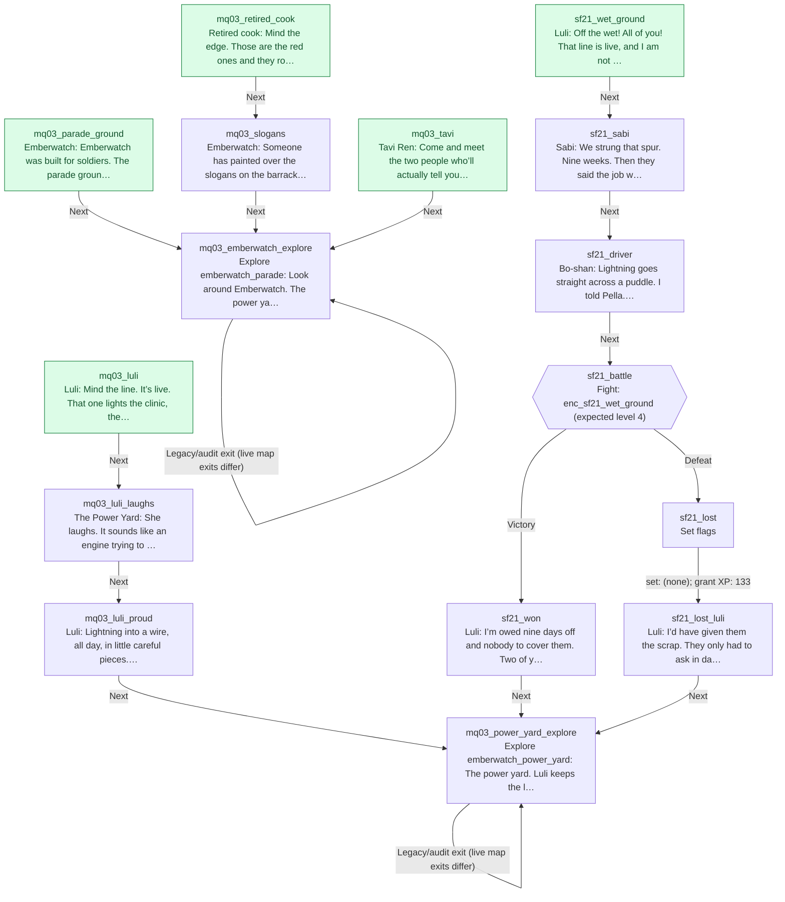

<!-- Generated by scripts/docs/story-graph.ts. Do not edit by hand. -->

# Emberwatch (Scene 3.1 and SF-2.1) story graph

[All story graphs](./README.md)

Source: [../regions/saltstepEmberwatch/emberwatch.ts](../../src/content/story/../regions/saltstepEmberwatch/emberwatch.ts).

16 nodes; 1 fights; 0 branches; 0 choices

Green nodes are story entry points (new game, map interactions, cross-file targets, or roots). Hexagons are fights; diamonds are flag branches. Purple placeholders exit this file; dashed placeholders continue in another part. Counts include owned story nodes only.

Edges preserve authored story-node transitions, including legacy/audit explore.next links. On connected maps, live map exits clear the story cursor and do not follow explore.next. Physical map travel and conditionally available NPC/trigger interactions are not edges here; this is not the complete world travel map. Dialogue variants change presentation, not control flow.

## Part 1: entry `mq03_luli`

16 owned nodes.

