<!-- Generated by scripts/docs/story-graph.ts. Do not edit by hand. -->

# MQ-02 Paper and Stone story graph

[All story graphs](./README.md)

Source: [../regions/saltstepEmberwatch/mq02.ts](../../src/content/story/../regions/saltstepEmberwatch/mq02.ts).

120 nodes; 1 fights; 5 branches; 2 choices

Green nodes are story entry points (new game, map interactions, cross-file targets, or roots). Hexagons are fights; diamonds are flag branches. Purple placeholders exit this file; dashed placeholders continue in another part. Counts include owned story nodes only.

Edges preserve authored story-node transitions, including legacy/audit explore.next links. On connected maps, live map exits clear the story cursor and do not follow explore.next. Physical map travel and conditionally available NPC/trigger interactions are not edges here; this is not the complete world travel map. Dialogue variants change presentation, not control flow.

## Part 1: entry `mq02_bowl_seller`

6 owned nodes.

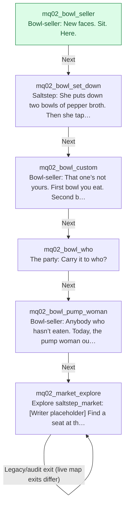

## Part 2: entry `mq02_coast_parcel`

2 owned nodes.

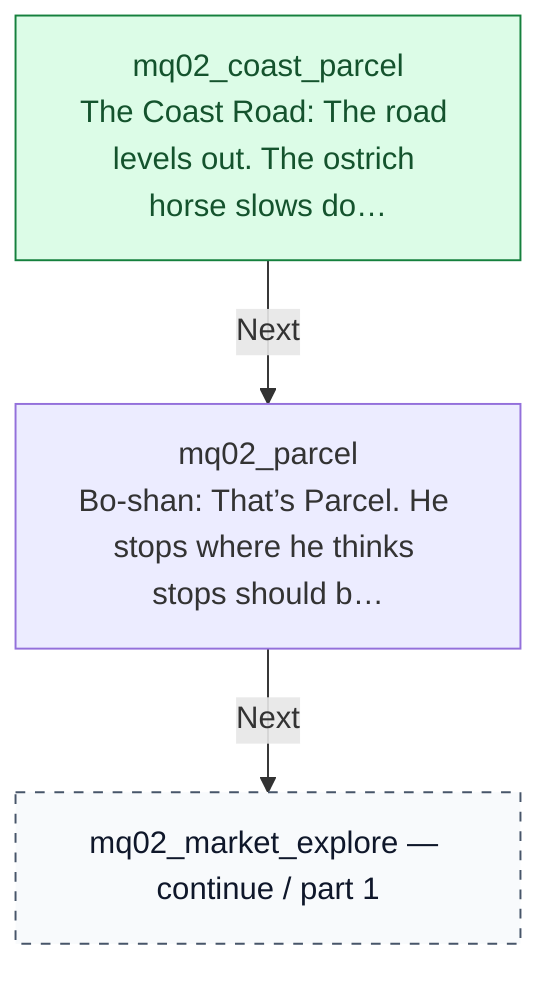

Continuations:

- `mq02_market_explore` → [mq02-paper-and-stone, part 1](./mq02-paper-and-stone.md#part-1)

## Part 3: entry `mq02_coast_road`

10 owned nodes.

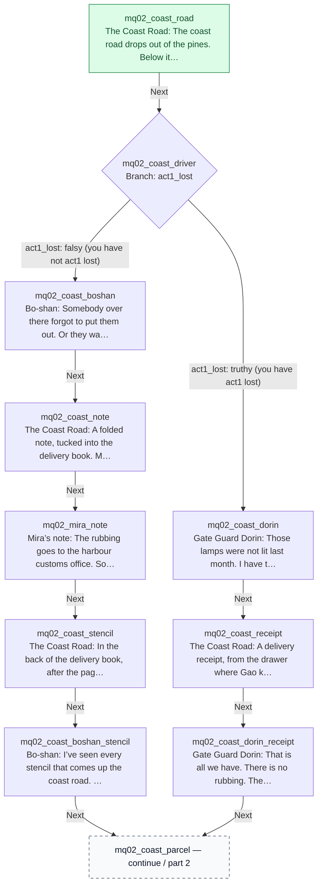

Continuations:

- `mq02_coast_parcel` → [mq02-paper-and-stone, part 2](./mq02-paper-and-stone.md#part-2)

## Part 4: entry `mq02_ferry`

9 owned nodes.

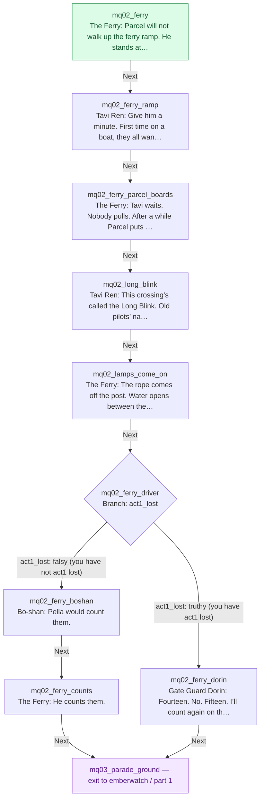

Continuations:

- `mq03_parade_ground` → [emberwatch, part 1](./emberwatch.md#part-1)

## Part 5: entry `mq02_freight_office`

2 owned nodes.

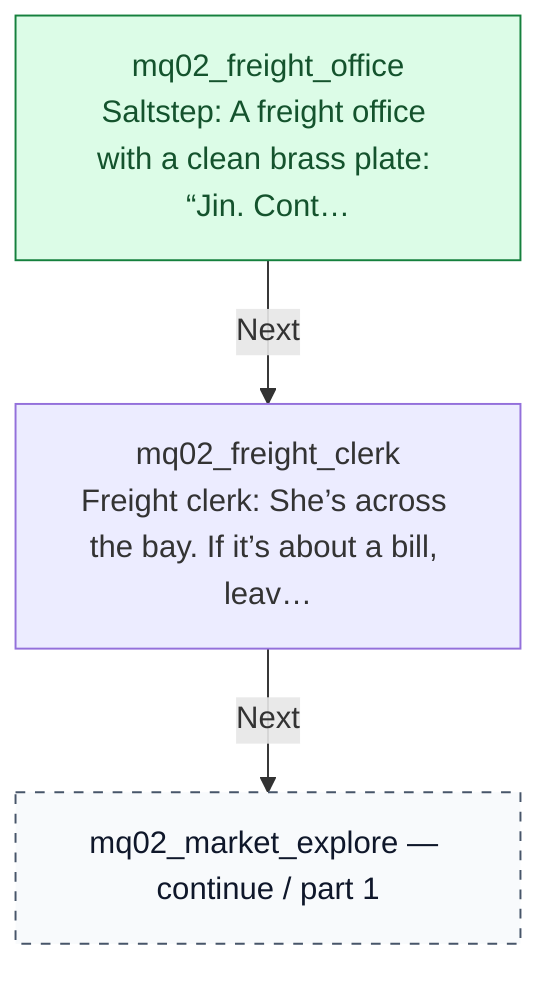

Continuations:

- `mq02_market_explore` → [mq02-paper-and-stone, part 1](./mq02-paper-and-stone.md#part-1)

## Part 6: entry `mq02_jin_hears_public`

1 owned nodes.

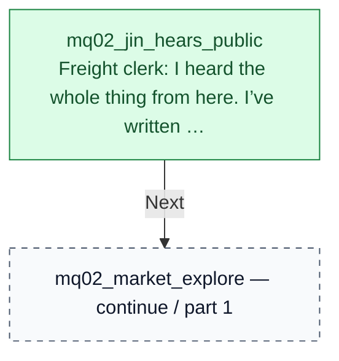

Continuations:

- `mq02_market_explore` → [mq02-paper-and-stone, part 1](./mq02-paper-and-stone.md#part-1)

## Part 7: entry `mq02_jin_hears_quiet`

1 owned nodes.

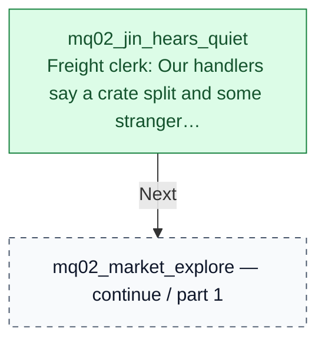

Continuations:

- `mq02_market_explore` → [mq02-paper-and-stone, part 1](./mq02-paper-and-stone.md#part-1)

## Part 8: entry `mq02_miri_crates`

1 owned nodes.

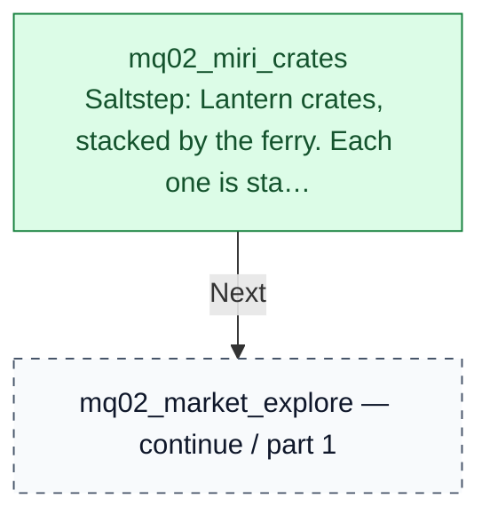

Continuations:

- `mq02_market_explore` → [mq02-paper-and-stone, part 1](./mq02-paper-and-stone.md#part-1)

## Part 9: entry `mq02_miri_crates_kaya`

4 owned nodes.

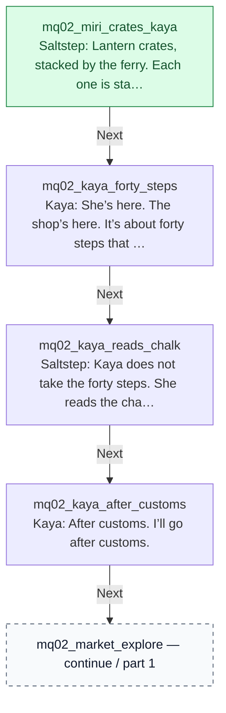

Continuations:

- `mq02_market_explore` → [mq02-paper-and-stone, part 1](./mq02-paper-and-stone.md#part-1)

## Part 10: entry `mq02_saltstep_arrival`

1 owned nodes.

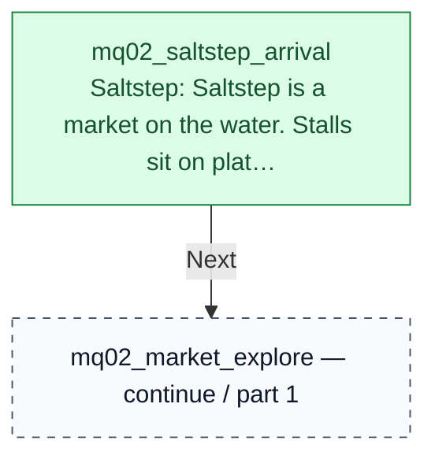

Continuations:

- `mq02_market_explore` → [mq02-paper-and-stone, part 1](./mq02-paper-and-stone.md#part-1)

## Part 11: entry `mq02_stall_drifts`

80 owned nodes.

```mermaid
flowchart TD
  n189["mq02_stall_drifts<br/>The Customs Stall: The customs office is a floating stall with …"]:::entry
  n187["mq02_stall_count<br/>Customs clerk: It says nine crates. I count ten. I can count to…"]
  n190["mq02_stall_handler<br/>Freight handler: Nine are freight. The tenth is safety material…"]
  n198["mq02_stall_stool<br/>Customs clerk: Everything gets counted. That’s why they gave me…"]
  n195["mq02_stall_rope<br/>The Customs Stall: The handler slaps the mooring post to make h…"]
  n105["mq02_approach<br/>Customs clerk: This happens. Keep talking, I can still hear you!"]
  n106["mq02_approach_jump<br/>The Customs Stall: You land on the stall. It dips, the seal swi…"]
  n108["mq02_approach_walk<br/>The Customs Stall: You run the plank walk beside the level pole…"]
  n107["mq02_approach_tow<br/>Tavi Ren: Again? That’s the third time this month. Get in. Sit …"]
  n193{"mq02_stall_reads<br/>Branch: act1_lost"}
  n194["mq02_stall_receipt<br/>The Customs Stall: However you get there, the clerk reads Gao’s…"]
  n196["mq02_stall_rubbing<br/>The Customs Stall: However you get there, the clerk reads the r…"]
  n191["mq02_stall_match<br/>Customs clerk: They match. Six sealed crates, landed here on a …"]
  n192["mq02_stall_plate<br/>Customs clerk: A Republic City plate. Came in four months back,…"]
  n188["mq02_stall_dorin_lamps<br/>Gate Guard Dorin: Commonworks put the lamps in at the Saltstep …"]
  n185["mq02_stall_boshan_lamps<br/>Bo-shan: Commonworks. They put the lamps in at the Saltstep fer…"]
  n197["mq02_stall_stamp<br/>Customs clerk: I stamp what the paper says. If the paper said “…"]
  n186["mq02_stall_bumps<br/>The Customs Stall: The stall bumps to a stop against the freigh…"]
  n177["mq02_pump_woman<br/>The Freight Pontoon: A woman in a dark blue work coat is kneeli…"]
  n203["mq02_veyra_bollard<br/>Veyra: If that’s for me, put it on the bollard. If you’re with …"]
  n169["mq02_party_broth<br/>The party: It’s a bowl of broth. The seller sent it."]
  n204["mq02_veyra_bowl_back<br/>Veyra: Did she say to bring the bowl back?"]
  n171["mq02_party_twice<br/>The party: Twice."]
  n208["mq02_veyra_laughs<br/>The Freight Pontoon: She laughs. It is a good laugh, and a slig…"]
  n206["mq02_veyra_corner<br/>Veyra: Then I’d better eat it. Veyra. Take that corner, would y…"]
  n130["mq02_corner_heavier<br/>The Freight Pontoon: You take the corner. It is heavier."]
  n213["mq02_veyra_pump<br/>Veyra: This goes to the low end of Saltstep. Hand pump. One per…"]
  n176{"mq02_pump_driver<br/>Branch: act1_lost"}
  n134["mq02_dorin_good_morning<br/>Gate Guard Dorin: Good morning. Dorin, gate guard, Ba Dan. I am…"]
  n111["mq02_boshan_tipping<br/>Bo-shan: You’ve got the rope the wrong way round. It’ll tip. I …"]
  n212["mq02_veyra_other_corner<br/>Veyra: Good morning, Dorin, gate guard. Take the other corner."]
  n214["mq02_veyra_show_me<br/>Veyra: Show me."]
  n133["mq02_dorin_echo<br/>The Freight Pontoon: Dorin takes the corner. The crate goes ont…"]
  n131["mq02_crate_tips<br/>The Freight Pontoon: Bo-shan shows her. The crate tips anyway, …"]
  n135["mq02_dorin_heard<br/>Gate Guard Dorin: I heard that. I am not going to write it down."]
  n110["mq02_boshan_on_purpose<br/>Bo-shan: That was on purpose."]
  n211["mq02_veyra_odd<br/>Veyra: Odd. The piles do that some days. I keep meaning to look…"]
  n161["mq02_laugh_echo<br/>The Freight Pontoon: He laughs. It carries across the flat wate…"]
  n217["mq02_veyra_tea<br/>The Freight Pontoon: She pours the last of her tea into the pot…"]
  n184["mq02_sling<br/>The Freight Pontoon: Across the pontoon, the freight handlers h…"]
  n118["mq02_clerk_put_down<br/>Customs clerk: That’s the one! Put it down! I haven’t counted i…"]
  n152["mq02_handler_paid<br/>Freight handler: We’re paid by the crate and the tide’s going. …"]
  n117["mq02_clerk_overboard<br/>The Freight Pontoon: The clerk grabs the sling rope. A handler …"]
  n219["mq02_veyra_winch<br/>Veyra: Stop that winch. That strap is going. There are people u…"]
  n153["mq02_handler_who<br/>Freight handler: Who are you to say?"]
  n216["mq02_veyra_strap<br/>Veyra: Somebody who can see a strap."]
  n160["mq02_lance<br/>The Freight Pontoon: They do not stop the winch. Two more handl…"]
  n205["mq02_veyra_coming<br/>Veyra: I’d rather not. Are you coming?"]
  n222{{"mq02_winch_battle<br/>Fight: enc_mq02_winch (expected level 4)"}}
  n224["mq02_winch_won<br/>The Freight Pontoon: The handlers lower the sling. Tavi poles t…"]
  n223["mq02_winch_lost<br/>Set flags"]
  n151["mq02_handler_docked<br/>Freight handler: We get docked for every crate that misses the …"]
  n109["mq02_barge_leaves<br/>The Freight Pontoon: The winch does not stop. The handlers swin…"]
  n218["mq02_veyra_who_docks<br/>Veyra: I do now. Who docks you?"]
  n136["mq02_duplicate_manifest<br/>Customs clerk: I’ll write you a duplicate manifest. Nine crates…"]
  n150["mq02_handler_contract<br/>Freight handler: The contract. Nobody. It just comes out."]
  n180["mq02_safety_materials<br/>The Freight Pontoon: The tenth crate has split along one corner…"]
  n172["mq02_pay_packet<br/>Customs clerk: That’s a pay packet. I know a pay packet. I get …"]
  n119["mq02_clerk_reads<br/>The Freight Pontoon: The clerk reads the front out loud, slowly."]
  n221["mq02_wages<br/>Customs clerk: “Stoneback Quarry. Lower galleries crew. Wages, …"]
  n179["mq02_rope_creaks<br/>The Freight Pontoon: Nobody says anything. A rope creaks."]
  n149["mq02_galleries<br/>Bo-shan: I was in those galleries. We were told the pay was lat…"]
  n215["mq02_veyra_somebodys_pay<br/>Veyra: That shouldn’t be in there. That’s somebody’s pay."]
  n207["mq02_veyra_hands_packet<br/>The Freight Pontoon: She turns the packet over, reads the back,…"]
  n210["mq02_veyra_log_it<br/>Veyra: Log it. Properly. Date and weight. Whoever packed that c…"]
  n138["mq02_ferry_bell<br/>The Freight Pontoon: Across the harbour, the ferry bell rings. …"]
  n202["mq02_veyra_before_dark<br/>Veyra: I have to get this fitted before dark or forty household…"]
  n209["mq02_veyra_leaves<br/>The Freight Pontoon: She wheels the handcart away along the pon…"]
  n201["mq02_two_ways<br/>Customs clerk: I can do this two ways. I can read that packet o…"]
  n200["mq02_tavi_how_it_goes<br/>Tavi Ren: Loud, and my crews will talk to you. Half of them hav…"]
  n220["mq02_vote<br/>The Customs Stall: How does Ba Dan’s complaint start?"]
  n173["mq02_public<br/>Saltstep: At noon the clerk stands on his stool at the level po…"]
  n178["mq02_quiet<br/>Saltstep: The clerk folds the copy small and seals it. A fish-s…"]
  n175{"mq02_public_witnesses<br/>Branch: lost_saltstep_docks"}
  n145["mq02_fish_seller<br/>Fish-seller: That’s a quarry crew’s wages you’ve got folded up …"]
  n174["mq02_public_two_sign<br/>Saltstep: The handlers have gone with the barge. The clerk sign…"]
  n132["mq02_dock_worker<br/>Dock worker: I loaded one of those. “Safety materials.” It clin…"]
  n170["mq02_party_rest_of_it<br/>The party: We want to see who’s holding the rest of it."]
  n182["mq02_second_dock_worker<br/>Second dock worker: Mine didn’t clink. Mine was light as bread.…"]
  n146["mq02_fish_seller_mm<br/>Fish-seller: Mm. Well. You’d know."]
  n163["mq02_market_explore — continue / part 1"]:::continuation
  n167["mq02_no_second_bowl — continue / part 12"]:::continuation
  n183["mq02_six_names — continue / part 12"]:::continuation
  n105 -->|"Jump aboard now."| n106
  n105 -->|"Follow along the pole walk."| n108
  n105 -->|"Ask Tavi for a tow."| n107
  n106 -->|"Next"| n193
  n107 -->|"Next"| n193
  n108 -->|"Next"| n193
  n109 -->|"Next"| n136
  n110 -->|"Next"| n161
  n111 -->|"Next"| n214
  n117 -->|"Next"| n219
  n118 -->|"Next"| n152
  n119 -->|"Next"| n221
  n130 -->|"Next"| n213
  n131 -->|"Next"| n110
  n132 -->|"Next"| n182
  n133 -->|"Next"| n135
  n134 -->|"Next"| n212
  n135 -->|"Next"| n211
  n136 -->|"Next"| n180
  n138 -->|"Next"| n202
  n145 -->|"Next"| n170
  n146 -->|"Next"| n167
  n149 -->|"Next"| n215
  n150 -->|"Next"| n180
  n151 -->|"Next"| n218
  n152 -->|"Next"| n117
  n153 -->|"Next"| n216
  n160 -->|"Next"| n205
  n161 -->|"Next"| n211
  n169 -->|"Next"| n204
  n170 -->|"Next"| n146
  n171 -->|"Next"| n208
  n172 -->|"Next"| n119
  n173 -->|"Next"| n175
  n174 -->|"Next"| n163
  n175 -->|"lost_saltstep_docks: truthy (you have lost saltstep docks)"| n174
  n175 -->|"lost_saltstep_docks: falsy (you have not lost saltstep docks)"| n132
  n176 -->|"act1_lost: truthy (you have act1 lost)"| n134
  n176 -->|"act1_lost: falsy (you have not act1 lost)"| n111
  n177 -->|"Next"| n203
  n178 -->|"Next"| n145
  n179 -->|"Next"| n149
  n180 -->|"Next"| n172
  n182 -->|"Next"| n183
  n184 -->|"Next"| n118
  n185 -->|"Next"| n197
  n186 -->|"Next"| n177
  n187 -->|"Next"| n190
  n188 -->|"Next"| n197
  n189 -->|"Next"| n187
  n190 -->|"Next"| n198
  n191 -->|"Next"| n188
  n192 -->|"Next"| n185
  n193 -->|"act1_lost: truthy (you have act1 lost)"| n194
  n193 -->|"act1_lost: falsy (you have not act1 lost)"| n196
  n194 -->|"Next"| n191
  n195 -->|"Next"| n105
  n196 -->|"Next"| n192
  n197 -->|"Next"| n186
  n198 -->|"Next"| n195
  n200 -->|"Next"| n220
  n201 -->|"Next"| n200
  n202 -->|"Next"| n209
  n203 -->|"Next"| n169
  n204 -->|"Next"| n171
  n205 -->|"Next"| n222
  n206 -->|"Next"| n130
  n207 -->|"Next"| n210
  n208 -->|"Next"| n206
  n209 -->|"Next"| n201
  n210 -->|"Next"| n138
  n211 -->|"Next"| n217
  n212 -->|"Next"| n133
  n213 -->|"Next"| n176
  n214 -->|"Next"| n131
  n215 -->|"Next"| n207
  n216 -->|"Next"| n160
  n217 -->|"Next"| n184
  n218 -->|"Next"| n150
  n219 -->|"Next"| n153
  n220 -->|"Read it out at the level pole.; set: inquiry_public=true"| n173
  n220 -->|"Seal a copy and carry it quietly.; set: inquiry_quiet=true"| n178
  n221 -->|"Next"| n179
  n222 -->|"Victory"| n224
  n222 -->|"Defeat"| n223
  n223 -->|"set: lost_saltstep_docks=true; grant XP: 90"| n109
  n224 -->|"Next"| n151
  classDef entry fill:#dcfce7,stroke:#15803d,color:#14532d
  classDef external fill:#f3e8ff,stroke:#7e22ce,color:#581c87
  classDef continuation fill:#f8fafc,stroke:#475569,color:#0f172a,stroke-dasharray:5 5
```

Continuations:

- `mq02_market_explore` → [mq02-paper-and-stone, part 1](./mq02-paper-and-stone.md#part-1)
- `mq02_no_second_bowl` → [mq02-paper-and-stone, part 12](./mq02-paper-and-stone.md#part-12)
- `mq02_six_names` → [mq02-paper-and-stone, part 12](./mq02-paper-and-stone.md#part-12)

## Part 12: entry `mq02_six_names`

2 owned nodes.

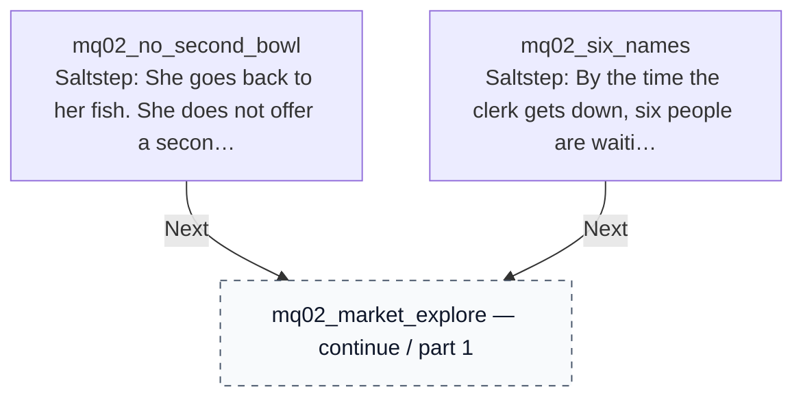

Continuations:

- `mq02_market_explore` → [mq02-paper-and-stone, part 1](./mq02-paper-and-stone.md#part-1)

## Part 13: entry `mq02_tavi`

1 owned nodes.

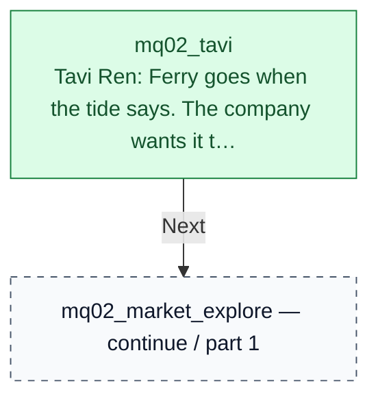

Continuations:

- `mq02_market_explore` → [mq02-paper-and-stone, part 1](./mq02-paper-and-stone.md#part-1)
