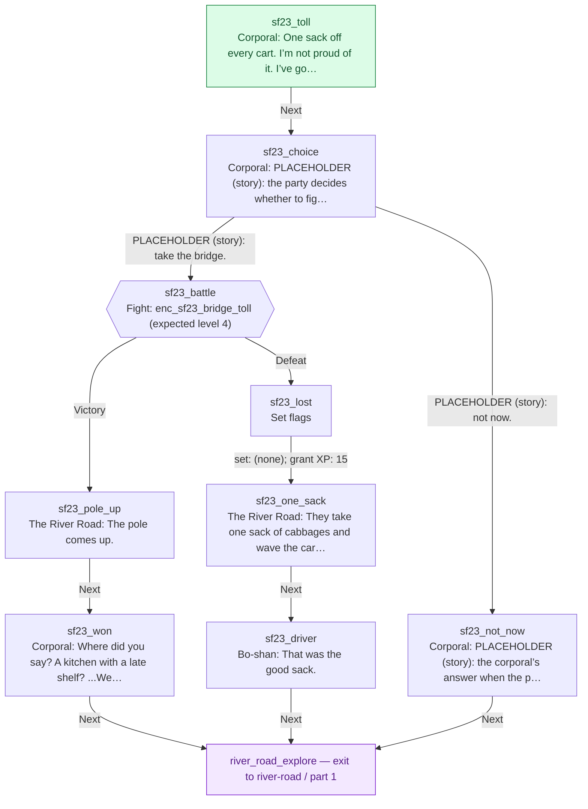

<!-- Generated by scripts/docs/story-graph.ts. Do not edit by hand. -->

# SF-2.3 The bridge toll story graph

[All story graphs](./README.md)

Source: [../regions/saltstepEmberwatch/sf23.ts](../../src/content/story/../regions/saltstepEmberwatch/sf23.ts).

9 nodes; 1 fights; 0 branches; 1 choices

Green nodes are story entry points (new game, map interactions, cross-file targets, or roots). Hexagons are fights; diamonds are flag branches. Purple placeholders exit this file; dashed placeholders continue in another part. Counts include owned story nodes only.

Edges preserve authored story-node transitions, including legacy/audit explore.next links. On connected maps, live map exits clear the story cursor and do not follow explore.next. Physical map travel and conditionally available NPC/trigger interactions are not edges here; this is not the complete world travel map. Dialogue variants change presentation, not control flow.

## Part 1: entry `sf23_toll`

9 owned nodes.

Continuations:

- `river_road_explore` → [river-road, part 1](./river-road.md#part-1)
