<!-- Generated by scripts/docs/story-graph.ts. Do not edit by hand. -->

# Act I side fights story graph

[All story graphs](./README.md)

Source: [sideFightsAct1.ts](../../src/content/story/sideFightsAct1.ts).

34 nodes; 2 fights; 7 branches; 0 choices

Green nodes are story entry points (new game, map interactions, cross-file targets, or roots). Hexagons are fights; diamonds are flag branches. Purple placeholders exit this file; dashed placeholders continue in another part. Counts include owned story nodes only.

Edges preserve authored story-node transitions, including legacy/audit explore.next links. On connected maps, live map exits clear the story cursor and do not follow explore.next. Physical map travel and conditionally available NPC/trigger interactions are not edges here; this is not the complete world travel map. Dialogue variants change presentation, not control flow.

## Part 1: entry `sf11_the_bend`

34 owned nodes.

```mermaid
flowchart TD
  n329{"sf11_back<br/>Branch when: you have act1 lost"}
  n330{{"sf11_battle<br/>Fight: enc_sf11_the_bend (expected level 3)"}}
  n331["sf11_bessa<br/>Bessa: The company owes us two months. The road paid us for thr…"]
  n332["sf11_bessa_else<br/>Bessa: ...Everybody else."]
  n333["sf11_bessa_sorry<br/>Bessa: Oh. It’s you. ...I did say sorry at the time. You were l…"]
  n334["sf11_driver<br/>Bo-shan: That crate is Dorin’s wheels. Forty of them, each the …"]
  n335["sf11_forty<br/>Gate Guard Dorin: Forty wheels. I have counted them twice. I am…"]
  n336["sf11_handcart_home<br/>The East Road: The four of them pull the handcart back to Ba Da…"]
  n337["sf11_lanfen<br/>Lanfen: Everybody except the people it belongs to."]
  n338["sf11_lost<br/>Set flags"]
  n339["sf11_over_the_hill<br/>The East Road: They get the handcart over the hill, but the whe…"]
  n340{"sf11_recognised<br/>Branch when: you have lost forest road"}
  n341["sf11_redesign<br/>Gate Guard Dorin: Thirty-nine wheels is nineteen axles and a sp…"]
  n342["sf11_supply_sack<br/>The East Road: The party’s food sack is on the handcart too, ne…"]
  n343["sf11_the_bend<br/>Lanfen: That is my washing line on your cart. I know it is mine…"]:::entry
  n344["sf11_thirty_nine<br/>Lanfen: Thirty-nine. The duck can keep whichever one it took."]
  n345{"sf11_wheels<br/>Branch when: you have act1 lost"}
  n346{"sf11_wheels_won<br/>Branch when: you have act1 lost"}
  n347["sf11_won<br/>Lanfen: The province pays me for four hands on this road every …"]
  n348{"sf12_back<br/>Branch when: you have act1 lost"}
  n349["sf12_backs_the_cart<br/>The Cutting: The driver backs the cart down the road and the pa…"]
  n350{{"sf12_battle<br/>Fight: enc_sf12_edge_on (expected level 3)"}}
  n351{"sf12_bo<br/>Branch when: Bo is with you"}
  n352["sf12_bo_crew<br/>Bo: I ran a crew of nine. I got to seven weeks before I stopped…"]
  n353["sf12_driver<br/>Bo-shan: That’s a good trick. I’d have thought of that."]
  n354["sf12_edge_on<br/>The Cutting: The slab is turned edge-on. A farm cart fits past …"]
  n355["sf12_lost<br/>Set flags"]
  n356{"sf12_ruon<br/>Branch when: you have ruon traded"}
  n357["sf12_ruon_spared<br/>Tolma: Ruon held that gate two months for the same money we did…"]
  n358["sf12_ruon_traded<br/>Tolma: You sold Ruon for a key. He was owed the same as us. I’l…"]
  n359["sf12_sets_her_feet<br/>The Cutting: She sets her feet. The slab doesn’t move. Everythi…"]
  n360["sf12_the_slab<br/>Tolma: Nothing with wheels. If I let the cabbages through today…"]:::entry
  n361["sf12_wind<br/>Tolma: Wind."]
  n362["sf12_won<br/>Tolma: Edge-on. Huh. Cabbages through, stone stays. I can hold …"]
  n14["cutting_after_explore — exit to world / part 1"]:::external
  n18["cutting_return_explore — exit to return / part 1"]:::external
  n44["forest_explore — exit to world / part 1"]:::external
  n47["forest_return_explore — exit to return / part 1"]:::external
  n329 -->|"when: you have act1 lost"| n44
  n329 -->|"otherwise (not: you have act1 lost)"| n47
  n330 -->|"Victory"| n336
  n330 -->|"Defeat"| n338
  n331 -->|"Next"| n337
  n332 -->|"Next"| n334
  n333 -->|"Next"| n330
  n334 -->|"Next"| n340
  n335 -->|"Next"| n329
  n336 -->|"Next"| n347
  n337 -->|"Next"| n332
  n338 -->|"set: (none); grant XP: 65"| n339
  n339 -->|"Next"| n344
  n340 -->|"when: you have lost forest road"| n342
  n340 -->|"otherwise (not: you have lost forest road)"| n330
  n341 -->|"Next"| n329
  n342 -->|"Next"| n333
  n343 -->|"Next"| n331
  n344 -->|"Next"| n345
  n345 -->|"when: you have act1 lost"| n341
  n345 -->|"otherwise (not: you have act1 lost)"| n329
  n346 -->|"when: you have act1 lost"| n335
  n346 -->|"otherwise (not: you have act1 lost)"| n329
  n347 -->|"Next"| n346
  n348 -->|"when: you have act1 lost"| n14
  n348 -->|"otherwise (not: you have act1 lost)"| n18
  n349 -->|"Next"| n361
  n350 -->|"Victory"| n354
  n350 -->|"Defeat"| n355
  n351 -->|"when: Bo is with you"| n352
  n351 -->|"otherwise (not: Bo is with you)"| n359
  n352 -->|"Next"| n359
  n353 -->|"Next"| n356
  n354 -->|"Next"| n362
  n355 -->|"set: (none); grant XP: 65"| n349
  n356 -->|"when: you have ruon traded"| n358
  n356 -->|"otherwise (not: you have ruon traded)"| n357
  n357 -->|"Next"| n351
  n358 -->|"Next"| n351
  n359 -->|"Next"| n350
  n360 -->|"Next"| n353
  n361 -->|"Next"| n348
  n362 -->|"Next"| n348
  classDef entry fill:#dcfce7,stroke:#15803d,color:#14532d
  classDef external fill:#f3e8ff,stroke:#7e22ce,color:#581c87
  classDef continuation fill:#f8fafc,stroke:#475569,color:#0f172a,stroke-dasharray:5 5
```

Continuations:

- `cutting_after_explore` → [world, part 1](./world.md#part-1)
- `cutting_return_explore` → [return, part 1](./return.md#part-1)
- `forest_explore` → [world, part 1](./world.md#part-1)
- `forest_return_explore` → [return, part 1](./return.md#part-1)
