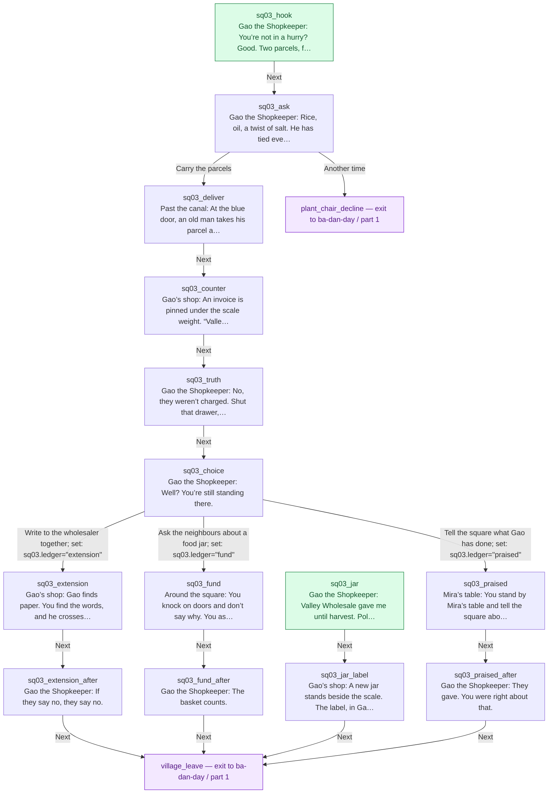

<!-- Generated by scripts/docs/story-graph.ts. Do not edit by hand. -->

# SQ-03 Gao’s Other Ledger story graph

[All story graphs](./README.md)

Source: [sq03GaosLedger.ts](../../src/content/story/sq03GaosLedger.ts).

14 nodes; 0 fights; 0 branches; 2 choices

Green nodes are story entry points (new game, map interactions, cross-file targets, or roots). Hexagons are fights; diamonds are flag branches. Purple placeholders exit this file; dashed placeholders continue in another part. Counts include owned story nodes only.

Edges preserve authored story-node transitions, including legacy/audit explore.next links. On connected maps, live map exits clear the story cursor and do not follow explore.next. Physical map travel and conditionally available NPC/trigger interactions are not edges here; this is not the complete world travel map. Dialogue variants change presentation, not control flow.

## Part 1: entry `sq03_hook`

14 owned nodes.

Continuations:

- `plant_chair_decline` → [ba-dan-day, part 1](./ba-dan-day.md#part-1)
- `village_leave` → [ba-dan-day, part 1](./ba-dan-day.md#part-1)
